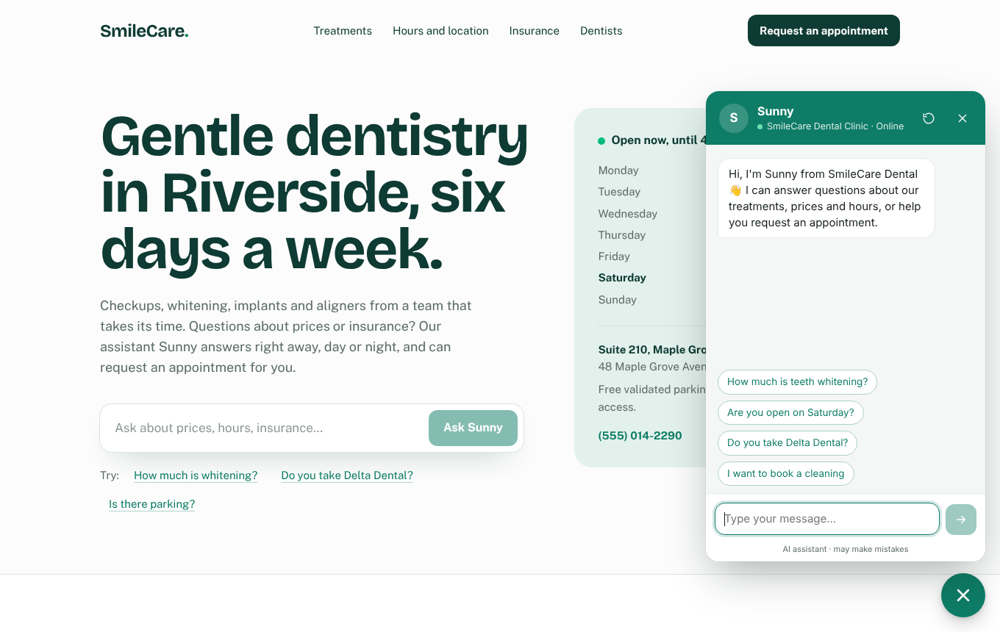
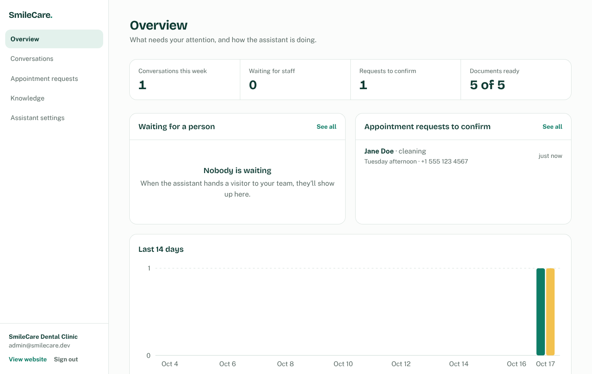
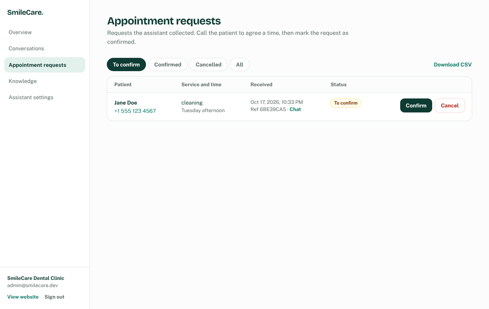
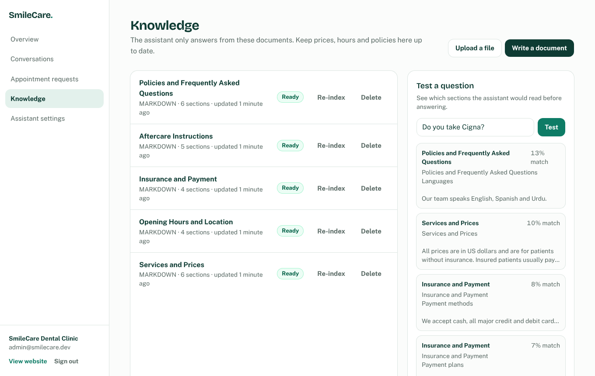
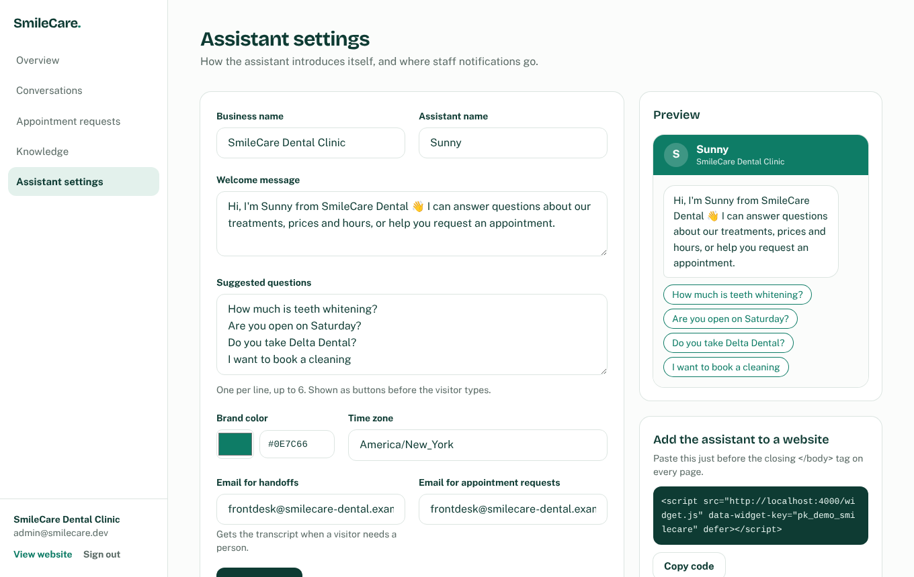
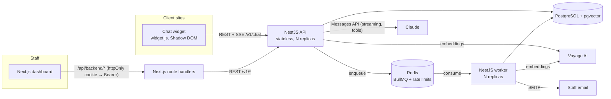

# SmileCare Assistant

An AI customer-support assistant for small businesses, shown here for a fictional dental clinic. It answers visitors' questions from the business's own documents, collects appointment requests through conversation, and hands the chat to a human when it can't help. It installs on any website with one `<script>` tag.

**Stack:** Next.js 16 · NestJS 11 · PostgreSQL 16 + pgvector · Redis + BullMQ · Claude API · Voyage AI embeddings · Docker



## What it does

- **Answers from the business's documents (RAG).** Every visitor question is embedded, matched against the knowledge base with pgvector, and Claude answers using only the retrieved sections. The dashboard shows which documents each answer came from.
- **Books appointments by conversation.** Claude collects name, phone and preferred time, confirms the details, then calls a `create_booking` tool. Staff get an email and see the request in the dashboard.
- **Hands off to a person.** When the visitor asks for a human, is unhappy, or asks something the documents don't cover, Claude calls `request_human_handoff`. The conversation is flagged and the transcript is emailed to staff.
- **Streams replies** token by token over Server-Sent Events.
- **One-line install.** The widget is a 17 KB script that runs in a Shadow DOM, so the host site's CSS can't break it. It remembers the conversation across page loads.
- **Staff dashboard:** what needs attention, conversation transcripts, appointment requests (confirm, cancel, CSV export), knowledge base (upload PDF/Markdown/text, re-index, test a question), and assistant settings with a live preview and the install snippet.
- **Multi-tenant.** Every row belongs to a business and every query is scoped by it, so one deployment can serve many clients, each with its own widget key.

| Dashboard overview | Appointment requests |
|---|---|
|  |  |
| **Knowledge base with retrieval tester** | **Assistant settings and install snippet** |
|  |  |

## Architecture



**How a message is answered**

1. The widget posts the message to `POST /v1/chat/sessions/:id/messages`.
2. The API embeds the question (short follow-ups are combined with the previous question) and runs a cosine-similarity search over that business's chunks.
3. It builds a system prompt with the business's rules, today's date in its time zone, and the retrieved sections, then streams Claude's reply to the widget.
4. If Claude calls a tool, the API validates the input, runs it, sends the result back to Claude, and keeps streaming. This loops until Claude finishes, with a configurable cap on rounds.
5. The reply, its sources and token usage are saved. Booking and handoff emails go through the queue, so a slow mail server never delays a reply.

### Design decisions

| Concern | Approach |
|---|---|
| **Swappable providers** | The LLM, embeddings and mailer are *ports* (interfaces) with *adapters* bound in one module each. The chat agent only knows `LlmPort`, so switching models or providers doesn't touch business logic. |
| **Adding capabilities** | Claude's tools are classes extending `ChatTool` with a zod schema. Input is validated before execution and the JSON Schema sent to Claude is generated from the same zod schema. Adding a tool is one class plus one line in `chat.module.ts`. |
| **Horizontal scaling** | The API is stateless: JWT auth, rate-limit counters in Redis, and no in-memory sessions. Document ingestion and emails run in a separate worker process from the same image. Scale each independently with `--scale api=3 --scale worker=2`. |
| **Reliability** | Jobs retry with exponential backoff. Ingestion is idempotent and swaps a document's chunks in one transaction, so search never sees a half-indexed document. Config is validated with zod at boot, so the process fails fast. |
| **Decoupling** | Modules publish domain events (`booking.created`, `conversation.handed_off`). Notifications subscribe to them, so the chat and booking code don't know email exists. |
| **Type safety end to end** | `@smilecare/shared` holds the API contracts used by the API, dashboard and widget. Drizzle gives typed queries, including the pgvector column. |
| **Security** | Admin tokens live in an httpOnly cookie behind a backend-for-frontend proxy and never reach browser JavaScript. Widget sessions are bound to a visitor id. Every admin query is tenant-scoped. Other protections: validation whitelists, per-IP limits (with a stricter budget for chat), Helmet, CSV formula-injection guarding, and a prompt that treats documents and visitor text as data, not instructions. |
| **Observability** | Structured JSON logs (pino) with a request id on every line, `/health` (Postgres + Redis) and `/health/live` probes, and Swagger docs at `/docs`. |

More detail: [docs/architecture.md](docs/architecture.md). Original project spec: [docs/spec.md](docs/spec.md).

## Project structure

```
apps/
  api/                    NestJS API + worker (same codebase, two entry points)
    src/
      config/             zod-validated environment
      infrastructure/     database (Drizzle schema, migrations, seed), queue, redis,
                          ai/llm (Claude adapter), ai/embeddings (Voyage), mail, logging
      modules/
        chat/             agent loop, prompt builder, tools (create_booking, request_human_handoff)
        knowledge/        upload, text extraction, chunking, ingestion worker, retrieval
        bookings/  conversations/  businesses/  auth/  notifications/  analytics/  health/
      main.ts             HTTP API entry
      worker.ts           queue worker entry
    test/                 e2e tests (real Postgres + Redis, scripted fake Claude)
  web/                    Next.js: demo clinic site + staff dashboard + BFF proxy
  widget/                 Embeddable chat widget (vanilla TS → dist/widget.js)
packages/
  shared/                 API contracts shared by all three apps
infra/nginx/              Reverse proxy config (SSE-safe)
```

## Run it locally

You need Node 22+, pnpm 10, Docker (for Postgres and Redis), an [Anthropic API key](https://console.anthropic.com/) and a [Voyage AI key](https://www.voyageai.com/).

```bash
pnpm install
pnpm infra:up                                  # Postgres (pgvector) + Redis in Docker

cp apps/api/.env.example apps/api/.env         # add ANTHROPIC_API_KEY and VOYAGE_API_KEY
cp apps/web/.env.example apps/web/.env.local

pnpm --filter @smilecare/shared build
pnpm db:migrate
pnpm db:seed                                   # demo clinic, admin user, 5 knowledge documents

pnpm dev                                       # API :4000, worker, dashboard :3000, widget watcher
```

- Clinic website with the widget: http://localhost:3000
- Staff dashboard: http://localhost:3000/admin (`admin@smilecare.dev` / `ChangeMe123!`)
- API docs: http://localhost:4000/docs

No Voyage key yet? Set `EMBEDDING_PROVIDER=local` and `RETRIEVAL_MIN_SCORE=0.1` to use the built-in offline embeddings. They match on shared words rather than meaning, so they're for development only.

## Install on any website

```html
<script src="https://your-api-domain.com/widget.js" data-widget-key="pk_your_key" defer></script>
```

Optional attributes: `data-position="left"`, `data-open="true"`, `data-api-url="https://…"`. The page can also control the widget with `window.SmileCareWidget.open()`, `.close()`, `.toggle()` and `.ask("question")`.

## Tests

```bash
pnpm typecheck
pnpm --filter @smilecare/api test        # unit: chunker, prompt builder, message mapping
pnpm --filter @smilecare/api test:e2e    # full chat pipeline against Postgres + Redis
```

The e2e suite runs the real NestJS app, database and queue, with Claude replaced by a scripted fake. It covers grounded answers with streaming, booking through tool calls, handoff, tenant and visitor isolation, auth, validation and analytics. CI runs everything on every push (`.github/workflows/ci.yml`).

## Deploy

One server with Docker:

```bash
cp .env.example .env          # domain, secrets, API keys, SMTP
docker compose up -d --build
docker compose run --rm api node dist/infrastructure/database/scripts/seed.js   # optional demo data
```

This starts Postgres, Redis, a one-off migration job, the API, the worker, the Next.js app and nginx on port 80. Put TLS in front with Cloudflare, a load balancer or `certbot --nginx`. Scale with `docker compose up -d --scale api=3 --scale worker=2`.

## Extending it

- **New tool for Claude** (check availability, look up an order, create a CRM lead): add a class in `apps/api/src/modules/chat/tools/` extending `ChatTool`, then list it in `TOOL_CLASSES` in `chat.module.ts`.
- **Different model:** set `CLAUDE_MODEL`. **Different provider:** implement `LlmPort` and bind it in `infrastructure/ai/ai.module.ts`.
- **New document type** (.docx, HTML, website crawl): add a case to `TextExtractor` and a source type in `@smilecare/shared`.
- **New reaction to events** (Slack alert, webhook, CRM sync): subscribe to `booking.created` or `conversation.handed_off` and enqueue a job.
- **New business:** insert a row in `businesses` with its own `widget_key`, and add an owner in `admin_users`. Everything else is scoped automatically.

## License

MIT
